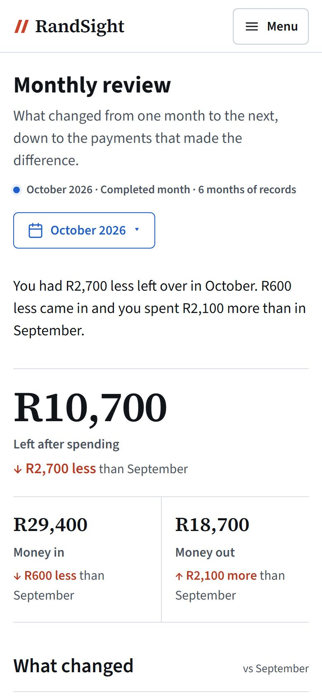

# RandSight

A monthly money review for a fictional bank customer: what changed from one month to the next, down to the payments that made the difference.

RandSight is a working name. The name and domain have not been checked for availability.

## Run with Docker

```sh
git clone https://github.com/SimzKubeka/randsight.git
cd randsight
docker build -t randsight .
docker run --rm -p 3000:3000 randsight
```

Open http://localhost:3000 and choose **Get started free**. The sign-in page lists the demo login:

- Email: `thandi@randsight.example`
- Password: `hindsight-demo`

Thandi is a fictional customer, and every amount is made up.

The build downloads two fonts from Google Fonts, so it needs network access. The database is created and seeded inside the container on the first request. To keep it between runs, mount a volume: `-v randsight-data:/app/data`.

If the site will be served from another address, pass it at build time so canonical URLs and the sitemap point there:

```sh
docker build --build-arg SITE_URL=https://randsight.example -t randsight .
```

The session cookie is marked `Secure` only when `SITE_URL` starts with `https`, so signing in also works on plain `http://localhost`.

## Run with Node

Needs Node 24.

```sh
npm ci
npm run build
DATABASE_PATH="$PWD/data/randsight.db" npm start
```

`DATABASE_PATH` must be absolute: the production server changes into `.next/standalone` when it starts.

For development, `npm run dev` serves http://localhost:3000 with the database in `data/`.

## Checks

```sh
npm run typecheck
npm run lint
npm test            # unit tests
npm run test:e2e    # builds, then runs the browser tests at phone and desktop sizes
npm run bench       # 50,000-payment customer: query timings and concurrent reads
```

CI runs typecheck, lint, unit and browser tests on every pull request, plus the dashboard tests against the Docker image.

## Walkthrough

The demo runs on a fixed date, Friday 20 November 2026, so the figures below always match.

1. **Monthly review.** After sign-in you land on October. The bar at the top answers the question first: you had R2,700 less left over than in September. R600 less came in and you spent R2,100 more.
2. **What changed.** Salary (R600 less), Medical (R1,200 more) and Groceries (R900 more) are the changes behind it, and together they add up exactly to R2,700.
3. **Drill down.** Choose **Medical spending**. A panel compares R400 in September with R1,600 in October and lists the three October payments, including a note Thandi left on one. Close it, or press Back, and focus returns to the Medical row.
4. **Chart or table.** The monthly spending chart switches to a table with the same numbers.
5. **Other months.** The month picker changes the URL, so any view can be bookmarked or shared.
6. **Live Track.** November groceries against a R6,000 target: R2,200 left, a pace line, and an estimate of where the month is heading (R5,700). **Apply sample payment** simulates one R450 bank payment: the figure drops to R1,750, the estimate moves to R6,375 and turns to "Heading over target", and the payment appears marked New. **Reset** puts it back. Each session sees only its own simulated payment.
7. **Docs.** The engineering docs are served at `/docs`. The sun and moon button switches between light and dark.



## Engineering docs

- [Architecture](docs/architecture.md): following one request through the app, the reporting rules, data model, sessions, and how Live Track would take a real bank feed.
- [Verification](docs/verification.md): what the tests cover, Lighthouse results and the 50,000-payment scale run.
- [Tech stack](docs/tech-stack.md): what is used, and what was left out on purpose.

Headline results from the verification page: Lighthouse accessibility 100 on the landing page and the dashboard. With 50,000 payments, the review's six-month totals take 1.1 ms. Under 20 concurrent signed-in sessions, the server handled 116 requests per second with a 188 ms p95 and no errors.

## Trade-offs

- **SQLite, one server.** It ships inside the image and needs no separate service, which suits a single-container submission. More than one server would need a shared database such as Postgres. Only `lib/data.ts` and the seed would change.
- **Few libraries.** There's no ORM, auth library, chart library, CSS framework or animation library. Each would replace a small amount of tested code, and leaving them out keeps the page weight and the security surface small. The cost is that I own that code: the session handling is about 60 lines on `node:crypto`.
- **Server-rendered, with state in the URL.** Pages are rendered on the server, and month, category and page live in the address. That gives working Back, bookmarks and refresh without a client-side data layer.
- **A fixed demo date.** Every figure is reproducible and testable. A real product would use today's date.
- **A simulated bank feed.** Live Track applies a sample payment instead of calling a bank. The proposed webhook path is described in the architecture doc and on the Live Track screen.
- **Performance is below target.** Lighthouse mobile performance is 87 on the landing page and 83 on the dashboard, against a target of 90. Pages paint in 0.9 s and nothing shifts. Most of the remaining cost is React starting up under Lighthouse's 4× CPU slowdown.

## Live preview

A preview runs at [randsight.vercel.app](https://randsight.vercel.app). **Docker (above) is the supported way to review RandSight.**

The preview may occasionally ask you to sign in again, and an applied Live Track payment may disappear. RandSight keeps its data in one SQLite file. Vercel runs the app on several short-lived server instances, each with its own temporary copy of that file, so a session created on one instance is unknown to the next. Docker and `npm start` run a single server with one database and don't have this problem. Fixing it on Vercel means a shared database, as described in [Why SQLite, and what changes with more servers](docs/architecture.md#why-sqlite-and-what-changes-with-more-servers).
