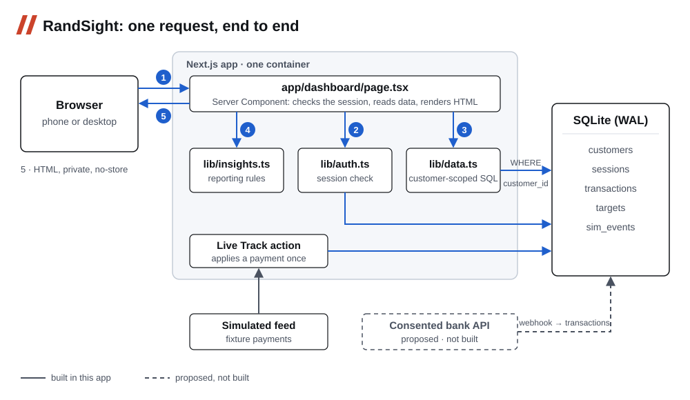

# Architecture

RandSight is one Next.js application (App Router, TypeScript) with a SQLite database file. There is no separate API service: Server Components read the data, and pure TypeScript functions turn it into the explanation the customer sees.

Solid lines are built. Dashed lines are a proposal, not part of this submission.

## Following the Medical drill-down

The numbers match the diagram.

1. **Request.** The browser asks for `/dashboard?month=2026-10&category=medical`. Month and category live in the URL, so the view can be bookmarked, refreshed and reached with Back.
2. **Session check.** `app/dashboard/page.tsx` is a Server Component. It calls `requireSession()` in `lib/auth.ts`, which hashes the `rs_session` cookie (SHA-256) and looks it up in `sessions`. No session, or an expired one, redirects to `/sign-in?next=…` so the customer returns to this exact view.
3. **Scoped queries.** `lib/data.ts` is the only module that reads customer data. Every query starts with `customer_id = ?`, and that id only ever comes from the session, never from the URL. The page asks for six months of totals (`SUM … GROUP BY month, category, kind`) and one page of October's medical payments, newest first.
4. **Calculation.** `lib/insights.ts` applies the reporting rules below, works out what changed since September, ranks the drivers and writes the two sentences at the top of the page. These are pure functions with no database or React, so the summary, chart, category list and payment total can't disagree.
5. **Response.** The HTML is rendered on the server and sent with `Cache-Control: private, no-store`. The only JavaScript on the page handles the menu and returning keyboard focus to the row the customer opened.

## Reporting rules

| Rule | Definition |
|---|---|
| Money | Integer cents everywhere; formatted only when displayed (`R2,700`, `R2,700.50`). |
| Timezone | `Africa/Johannesburg`. A payment at 23:30 on 31 October is October, even though it is already 21:30 UTC. |
| Money in | Income credits in the month. |
| Money out | Spending minus refunds, per category. A refund counts in the month it posts, against its own category. |
| Transfers | Moves between the customer's own accounts. Excluded from money in, money out and every insight. |
| Left after spending | Money in less money out. Not the account balance. |
| Comparison | The selected month against the previous calendar month. |
| Empty month | No comparison sentence; the page says there is nothing to compare with. |
| Zero baseline | A category with nothing last month is "new"; no percentage is ever divided by zero. |

Each driver records its effect on money left over, so the drivers always add up exactly to the headline change. For October: R600 less income + R1,200 more medical + R900 more groceries = R2,700 less left over.

## Data

| Table | Holds |
|---|---|
| `customers` | Email, name and a scrypt password hash. |
| `sessions` | SHA-256 of each session token, the customer and an expiry time. |
| `transactions` | One row per payment: UTC time, reporting month, merchant, category, kind (`income`, `spend`, `refund`, `transfer`), amount in cents, optional customer note. |
| `targets` | Monthly spending targets (Live Track). |
| `sim_events` | Simulated feed events applied in a session (Live Track). |

The reporting month is stored alongside each payment, so month filters use an index (`customer_id, month, posted_at, id`) instead of doing timezone maths in SQL. Paging is ordered by `posted_at DESC, id DESC`, which stays stable when two payments share a timestamp.

On first use the app creates the schema and seeds a fictional demo customer, a second customer (used to prove one customer can't read another's data) and their payments. A separate script adds a 50,000-transaction customer for scale tests.

## Sessions and access

- Passwords are hashed with scrypt from Node's `crypto` module, salted, and compared in constant time. An unknown email still runs a password check, so timing doesn't reveal which accounts exist.
- A session is 32 random bytes in an HTTP-only, `SameSite=Lax` cookie, `Secure` when the site runs on HTTPS. Only its SHA-256 is stored, so a copy of the database holds no usable cookies.
- Sessions last eight hours. Sign-out deletes the session on the server.
- After sign-in, the app only redirects to `/dashboard…` addresses, which blocks open redirects.
- Five failed sign-ins for an email from one address pause sign-in for 15 minutes.
- Personalised pages are dynamic, marked `noindex`, sent `private, no-store`, and left out of the sitemap.

## Why SQLite, and what changes with more servers

SQLite fits a single-container submission: it is mostly reads, needs no separate service, and ships with the image. It runs in WAL mode, so readers don't block each other.

With several application instances, a local file stops working because each instance would have its own copy. The changes would be:

- **Database:** move to a managed Postgres. Only `lib/data.ts` and the seed change; the reporting functions stay as they are.
- **Sessions and sign-in limits:** move to the shared database or Redis instead of per-process memory.
- **Live Track simulation:** follows the session store.

## Live Track: simulated feed now, bank API later

Live Track shows the current month against a grocery target, using a fixed demo date of 20 November 2026. It leads with what is left (R2,200 of R6,000), then a separate line compares spending with an even pace: the target × today’s day ÷ the days in the month (R4,000 by day 20 of 30). The pace line describes how the month is going; it is not a forecast.

Beside it, “Where November is heading” gives the one estimate on the page, always worded as “if spending continues at this rate”: spent ÷ days so far × days in the month, to the nearest rand (R5,700, R300 under target). A chart shows the running total by day against the even pace and the target, with a dashed line to month end that turns vermilion when the estimate passes the target. Under the figure, the remaining allowance is spread over the days left (“Up to R220 a day for the next 10 days”). All of this is pure maths in `lib/live-track.ts`, unit-tested with the fixture figures.

A simulated feed applies one sample payment (R450 at Marula Market) for the signed-in session only. Applying it twice counts it once (`INSERT OR IGNORE` on session and event id), another session for the same customer is untouched, and reset or signing out removes it. Applying it moves the estimate to R6,375, R375 over the target, which is the point of the demo: one payment changes where the month is heading. The forms are server actions that work without JavaScript; with it, the new figure is announced through a polite live region and focus moves to the next control.

A real feed would come from a consented bank API (an account-information provider). The proposed path: the provider calls a webhook route, the app verifies the signature, maps each item to the `transactions` shape with the provider's id as a unique key, and inserts it with `INSERT OR IGNORE`. That replaces the simulated feed without touching the reporting code. It is not built in this submission, and the screen says so: a “Where these payments come from” section shows the bank → consented feed → RandSight path and marks the feed as simulated.

See also: [Tech stack](tech-stack.md) · [Verification](verification.md)
